# Climate Circuits – architektúra

Stav k 2026-10-06. Rozhodnutia a ich dôvody sú v [decisions.md](decisions.md), plán v [next-steps.md](next-steps.md).
Každá časť je označená: **Hotové** (v kóde a nasadené), **Plánované** (navrhnuté, ešte nie je v kóde).

## Cieľ a rozsah

Climate Circuits je custom integrácia pre Home Assistant. Nahrádza sadu template senzorov, skriptov a automatizácií kúrenia jednou integráciou, ktorá sa do ďalšieho domu nasadí konfiguráciou v UI, bez písania YAML.

**Rieši:**
- určenie režimu domu (kúrenie / chladenie / vypnuté) pri ľubovoľnom zdroji tepla,
- 1 až N okruhov: požiadavka zo zón, čerpadlo, zmiešavač, cieľová teplota vody podľa ekvitermickej krivky,
- vysvetlenie, prečo sa kúri alebo nekúri, v entitách aj v paneli Aktivita,
- homing zmiešavačov a ochranu ich motorov (plánované),
- vypnutie kúrenia a chladenia pri otvorenom okne ako zapínateľný modul (plánované),
- voliteľnú požiadavku na zdroj tepla (kotol), keď sa nereguluje sám (plánované),
- cirkulačné čerpadlo TUV s hysteréziou (voliteľný modul).

**Nerieši:**
- termostaty v izbách: integrácia ich iba číta, ostávajú `generic_thermostat` alebo iné `climate` entity a spínajú hlavice zón,
- rozvrhy teplôt (Climate Scheduler a pod.),
- prípravu (ohrev) TUV; rieši iba jej cirkuláciu,
- ovládanie I/O dosiek: integrácia pracuje s existujúcimi entitami (`switch`, `cover`, `sensor`), nie priamo s hardvérom.

## Princípy

1. **I/O dosky sú čisté vzdialené I/O.** Interlocky, maximálna doba zopnutia aj stav po reštarte rieši integrácia, nie firmvér dosky.
2. **Každý výstup má jedného vlastníka.** Integrácia pravidelne zosúlaďuje skutočný stav s požadovaným, takže reštart dosky alebo výpadok spojenia sa opraví sám.
3. **Bezpečný stav pri chýbajúcich dátach.** Nedostupný senzor znamená „nerob nič“ alebo bezpečnú záložnú hodnotu, nikdy 0 °C prepočítanú do regulácie.
4. **Konfigurácia cez UI.** Config flow domu, options flow na zmeny, okruhy ako subentries. Žiadny YAML.
5. **Viditeľné rozhodnutia.** Každá entita, ktorá rozhoduje, má atribút `reason`; zmeny sa zapisujú do Aktivity.
6. **Distribúcia cez GitHub a HACS** (zatiaľ ručné nasadenie, pozri [Nasadenie](#nasadenie)).

## Štruktúra kódu

```
custom_components/climate_circuits/
├── core/                 čisté jadro, bez importu Home Assistant, testované priamo
│   ├── mode.py           režim domu zo zdrojov
│   ├── demand.py         požiadavka okruhu zo zón
│   ├── explain.py        prečo okruh kúri / nekúri, stav každej zóny
│   ├── texts.py          vety vysvetlení (sk / en)
│   ├── curve.py          ekvitermické krivky, rosný bod, cieľ vody
│   ├── circulation.py    hysteréza cirkulácie TUV
│   ├── zones.py          ktoré termostaty vypnúť / zapnúť pri zmene režimu
│   └── mixer.py          model polohy a krok regulácie zmiešavača (zatiaľ nepoužité)
├── house.py              runtime: dom, okruhy, cirkulácia TUV, prepínanie termostatov; píše Aktivitu
├── settings.py           typované nastavenia z options a subentries (kľúče ako reťazce)
├── const.py              doména, intervaly, predvolené krivky
├── config_flow.py        dom, options, subentry okruhu
├── activity.py           zápis do Aktivity (logbook)
├── logbook.py            popis udalostí pre logbook
├── entity.py             zariadenie domu a okruhov
├── card.py               sprístupnenie karty a registrácia ako Lovelace resource
├── sensor.py, binary_sensor.py, select.py, switch.py, number.py (cirkulácia TUV)
└── frontend/climate-circuits-curve-card.js   interaktívna karta krivky
```

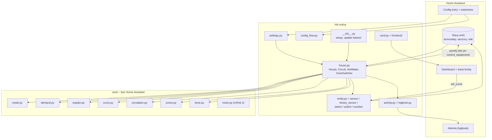

### Beh – jedno vyhodnotenie

Dom sa vyhodnocuje pri každej zmene sledovaných entít a každých 30 s. Pred vytvorením entít sa vyhodnotí raz, aby žiadna entita nezačala so zlým stavom.

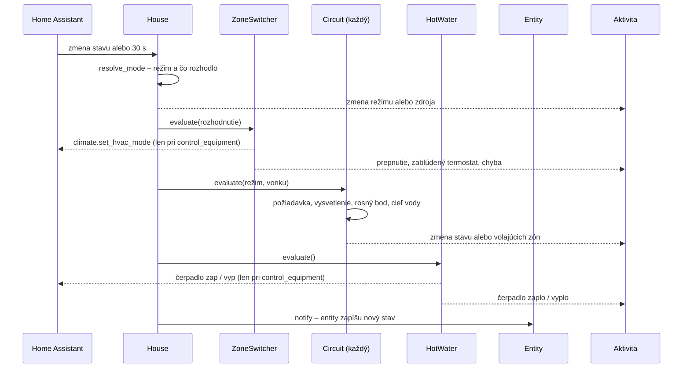

## Režim domu – Hotové

Režim (`heat` / `cool` / `off`) určí prvý dostupný zdroj v pevnom poradí. Výsledok je v `sensor.climate_circuits_mode`, atribút `source` hovorí, ktorý zdroj rozhodol.

| Poradie | Zdroj | Ako rozhoduje |
|---|---|---|
| 1 | Ručný prepínač `select.climate_circuits_mode_override` | `heat` / `cool` / `off` platia priamo; `auto` posunie rozhodnutie ďalej |
| 2 | Entita zdroja tepla (voliteľná) | `climate`: `hvac_mode` heat/cool/off; `select` / `sensor`: mapovanie hodnôt z konfigurácie; `binary_sensor` / `switch`: on → heat, off → off |
| 3 | Záloha podľa teploty (voliteľná) | nádrž: ≥ prah kúrenia → heat, ≤ prah chladenia → cool, medzi nimi posledný režim; vonkajšia teplota: ≤ prah → heat, ≥ prah → cool, medzi nimi off |
| 4 | Posledný známy režim | keď nič z vyššie nie je dostupné; bez histórie `off` |

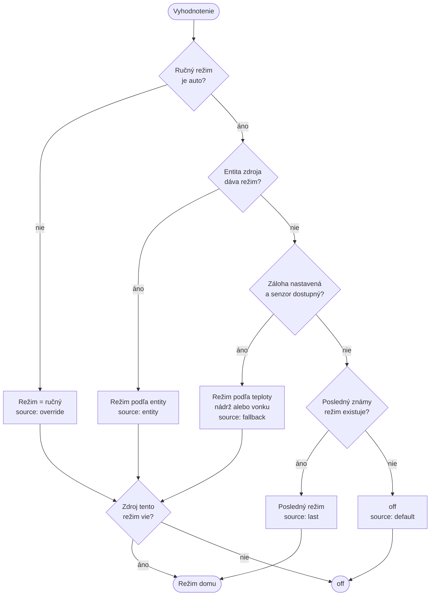

**Schopnosti zdroja:** v nastavení domu sa zvolí, čo zdroj vie (plynový kotol iba `heat`, tepelné čerpadlo `heat` aj `cool`). Režim mimo schopností sa nikdy nevyberie, rozhodne sa `off`.

Atribúty senzora režimu: zdroj a čo rozhodlo, stav a činnosť entity zdroja, teplota zálohy s prahmi, vonkajšia teplota a voliteľné „zobrazované senzory“ (napr. TUV, výstup a spiatočka tepelného čerpadla).

## Okruhy – Hotové (čítanie), Plánované (výstupy)

Okruh je jedna vetva s vlastným čerpadlom a/alebo zmiešavačom, zónami a krivkami. Okruhov je ľubovoľný počet, nie sú viazané na poschodia. Režim domu je spoločný pre všetky okruhy.

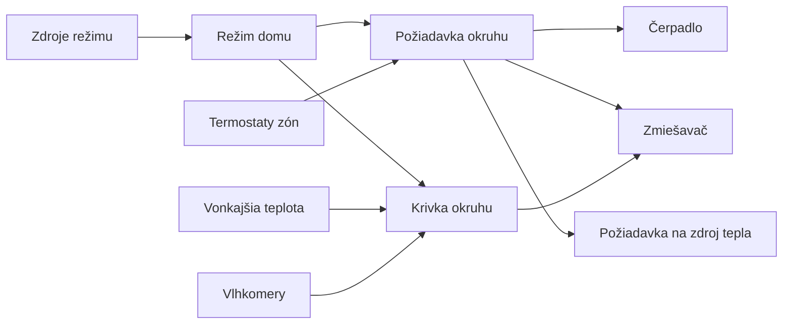

### Zóny a požiadavka – Hotové
- Okruh má dva zoznamy zón: termostaty na kúrenie a termostaty na chladenie. Každý môže byť prázdny.
- Požiadavka je `on`, keď aspoň jedna zóna zo zoznamu pre aktuálny režim má `hvac_action` `heating` / `preheating` (kúrenie) alebo `cooling`.
- Okruh bez zón pre daný režim beží vždy, keď dom nie je `off`.
- Nedostupný termostat nežiada.

### Vysvetlenie stavu – Hotové
`sensor.<okruh>_state`: `heating` / `cooling` / `idle` / `off`, atribút `reason` jednou vetou a riadok pre každú zónu:

| Stav zóny | Kedy |
|---|---|
| kúri / chladí | `hvac_action` je `heating`, `preheating` alebo `cooling` |
| teplota dosiahnutá | aktuálna ≥ cieľ (pri chladení ≤) |
| čaká v tolerancii | nedosiahla cieľ, ale termostat ešte nespína (tolerancia `generic_thermostat`) |
| termostat vypnutý | `hvac_mode` alebo `hvac_action` je `off` |
| nedostupný | entita nedostupná |

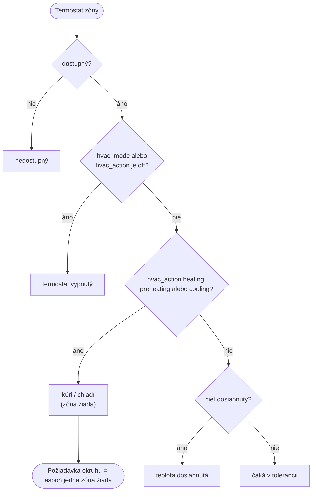

### Ekvitermické krivky – Hotové

Každý okruh má vlastnú krivku kúrenia a chladenia. Krivka je orezaná na [min, max].

**Kúrenie** – fyzikálny model vykurovacích telies (výkon rastie s ΔT^n):

```
φ      = (izba − vonku) / (izba − vonku_návrh)        (0, keď je vonku teplejšie ako v izbe)
T_voda = izba + (T_návrh − izba) · φ^(1/n) + korekcia
```

- Krivka prechádza bodom (izba, izba) a návrhovým bodom (vonku_návrh, T_návrh).
- n ≈ 1,3 pre radiátory, ≈ 1,1 pre podlahové kúrenie. Pri miernom mraze stúpa rýchlejšie, pri silnom sa ohýba, ako krivky v katalógoch.
- Parametre: izba, návrhová vonkajšia teplota, návrhová teplota vody, exponent, korekcia, min, max.

Krivka F1 (izba 22 °C, návrh −15 °C → 50 °C, n 1,3, min 35, max 50). Horná čiara je krivka bez orezania, dolná výsledná cieľová teplota vody:

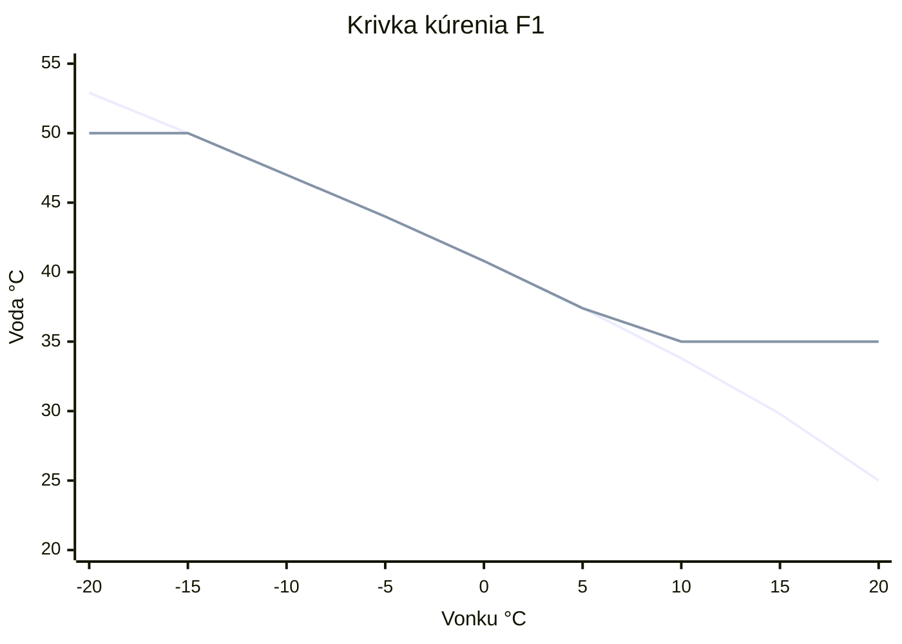

**Chladenie** – priamka:

```
T_voda = izba − strmosť · (vonku − izba) + korekcia
```

- Nikdy nie pod rosný bod + 2 K. Rosný bod okruhu = rosný bod najvyššej teploty termostatov a najvyššej vlhkosti vlhkomerov okruhu (konzervatívne, senzory nie sú párované po izbách).

Krivka chladenia F1 (izba 24 °C, strmosť 0,5, min 16, max 22), bez obmedzenia rosným bodom:

```mermaid
xychart-beta
  title "Krivka chladenia F1"
  x-axis "Vonku °C" ["20", "25", "30", "35", "40"]
  y-axis "Voda °C" 14 --> 24
  line [22.0, 22.0, 21.0, 18.5, 16.0]
```

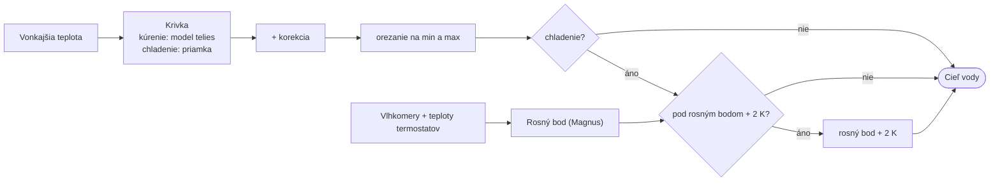

**Nedostupná vonkajšia teplota:** kúrenie min, chladenie max (najmiernejšia hodnota).

Výsledok je v `sensor.<okruh>_target_water_temperature` s atribútmi `reason`, `dew_point`, `outdoor_temperature` a dátami pre kartu (parametre oboch kriviek, aktuálny režim domu). Parametre mení služba `climate_circuits.set_curve` na tomto senzore.

### Čerpadlo – Hotové lokálne (míľnik 2)
- Zapne sa, až keď požiadavka okruhu trvá dobu otvárania termoelektrických hlavíc (predvolene 3 min). Hlavice ovláda termostat, preto integrácia čaká na trvanie požiadavky, nie na potvrdenie ventilu.
- Požiadavka na zdroj tepla ide až po potvrdení, že čerpadlo beží.
- Po skončení požiadavky: pri kúrení dobeh (3 min), pri chladení vypne hneď.
- Stav sa synchronizuje každú minútu, takže sa obnoví aj po reštarte I/O dosky.

### Zmiešavač – Hotové lokálne (míľnik 2)
- Typ: 3-bodový pohon cez dve relé (otvor / zatvor) alebo analógový výstup 0–10 V (`number`).
- Polohu počíta integrácia sama z potvrdených časov zopnutia relé (bez `cover_time_based`).
- Regulácia: krok 4 % zdvihu na 1 K odchýlky (2–20 %), hysteréza; po pohybe čaká čas ustálenia (pole okruhu, predvolene 150 s), kým voda dotečie k senzoru; nerobí krok, keď teplota prívodu podľa trendu posledných 2 min dosiahne cieľ do času ustálenia. „Otvoriť“ znamená viac tepla pri kúrení aj viac chladu pri chladení. Bez požiadavky sa zmiešavač zatvorí (dotlak potom najviac raz za 6 h).
- Nepovinný senzor zdroja (akumulačka, výstup tepelného čerpadla): pri zmene zdroja o dT sa zmiešavač hneď pohne o `−p·(1−p)·dT/(zdroj − prívod)`, aby prívod ostal; zvyšok dorovná spätná väzba. Teplota zdroja je atribút polohy zmiešavača.
- Dotlak na doraze počas regulácie (2 s impulz pri 0 % / 100 %) najviac raz za 10 min; pri dosiahnutí dorazu dobeh 2 s.
- Ochrana motora: nikdy nezopne opačný smer, kým nemá potvrdené vypnutie prvého, pauza medzi smermi, maximálna doba zopnutia (dráha + rezerva), po obnovení spojenia najprv vypne obe relé.
- Homing (celá dráha + dotlak), keď poloha nie je známa: prvý štart, relé zopnuté pri štarte, pohyb prerušený vypnutím HA, relé nedostupné počas pohybu dlhšie ako 5 s, homing skrátený niekým iným, 7 dní bez pohybu. Inak sa po štarte pokračuje z uloženej polohy.
- Nastavenie domu **Homovať zmiešavače pri štarte HA** (Ochrany, predvolene vypnuté): pri štarte Home Assistanta zahodí uloženú polohu, takže sa zmiešavač ~30 s po štarte zahomuje. Pri reloade integrácie nie.
- Krátky výpadok relé (`unavailable` do 5 s) počas pohybu polohu nezahodí; výpadok v kľude sa nepočíta ako pohyb.

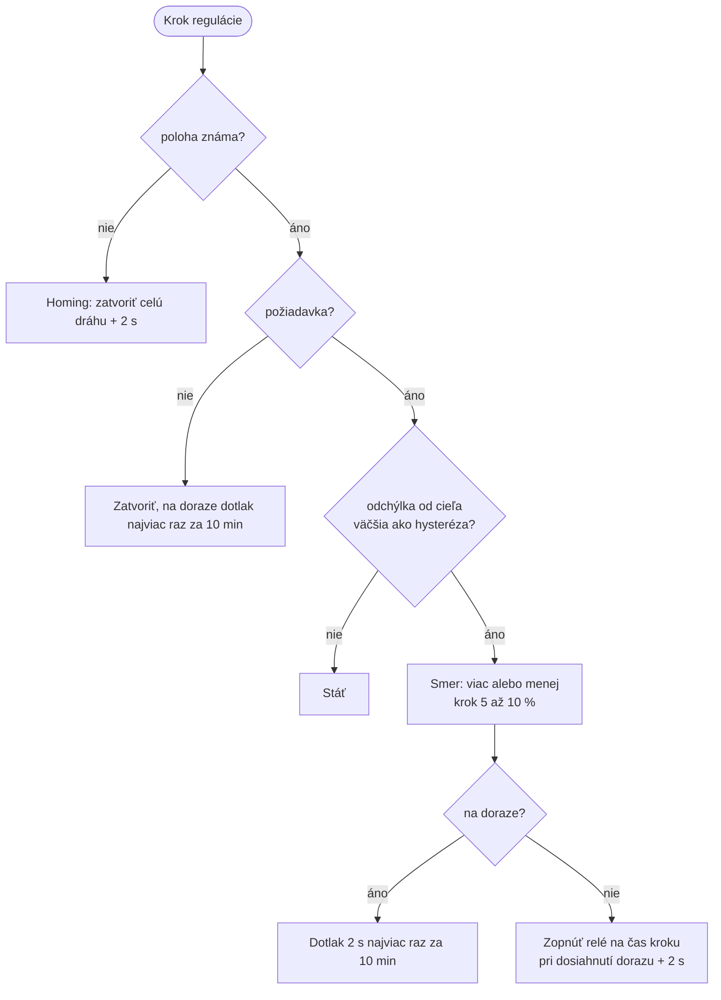

## Zdroj tepla – samostatná časť integrácie (2026-10-12)

Zdroj (akumulačná nádrž, kotol, tepelné čerpadlo, hydraulický separátor) je vlastná časť integrácie (config subentry typu `source`), rovnako ako okruh. Má vlastné zariadenie v HA.

- **Zdroj:** názov, senzor teploty vody, ktorú zdroj dáva okruhom (pri akumulačke jej horná časť).
- **Entita:** `sensor.<zdroj>_temperature`.
- **Okruh si vyberie zdroj** v sekcii Výstupy. Keď je v dome jediný zdroj a okruh žiadny nemá vybraný, použije ten. Bez zdroja okruh reguluje len podľa prívodu.
- **Regulácia zmiešavača** berie teplotu zdroja odtiaľto (kompenzácia zmeny zdroja). Dočasne sa ešte číta staré pole okruhu `source_sensor` z verzie 0.1.3, keď okruh zdroj nemá.
- **Pokryté prípady:** jedna nádrž pre všetky okruhy, dve nádrže za sebou (jeden zdroj, senzor na výstupe), dva zdroje pre rôzne okruhy, neskôr samostatná nádrž na chladenie (zdroj pri chladení).
- **Neskôr sem patrí** požiadavka na zdroj (tabuľka nižšie) a záložný senzor režimu (dnes v nastaveniach domu).

### Požiadavka na zdroj – Plánované

| Zdroj | Režimy | Výstup požiadavky | Poznámka |
|---|---|---|---|
| Tepelné čerpadlo s vlastnou reguláciou a nádržou | heat, cool | žiadny | dnešný dom |
| Plynový kotol s beznapäťovým vstupom | heat | `switch` | on, keď má požiadavku aspoň jeden okruh |
| Kotol s OpenTherm | heat | `climate` / `number` | požiadavka + najvyšší cieľ vody z okruhov s požiadavkou |
| Elektrokotol / pevné palivo s akumulačkou | heat | `switch` alebo žiadny | |

Požiadavka zdroja = OR požiadaviek okruhov; minimálna doba behu a pauzy; pri `off` vždy vypnutá.

## Bezpečnosť a prevádzka – Hotové lokálne (okrem ochrany pred mrazom)

Prevzaté z projektu [Hydronicus](https://github.com/brumi1024/ha-hydronicus) (MIT), porovnanie v [hydronicus-porovnanie.md](hydronicus-porovnanie.md).

- **Skúšobný režim a ozbrojovanie:** prepínač `switch.climate_circuits_control_equipment` je pri novom dome vypnutý, integrácia povely iba navrhuje (atribút `proposed`). Výstupy sa ozbrojujú po jednom.
- **Potvrdzovanie povelov:** povel platí, až keď ho HA ukáže v stave entity; opakovanie po 10 s, po 3 pokusoch jedno hlásenie v Aktivite, po 5 min nový pokus (Repair a stav `degraded` zatiaľ nie).
- **Zmena kúrenie ↔ chladenie:** starý režim sa zastaví, nový sa spustí po pauze (predvolene 1 h); návrat do posledného režimu bez pauzy.
- **Ochrana pred mrazom:** zóna pod 5 °C sa kúri aj pri `off` (zapnutím kúrenárskeho termostatu), kým sa neohreje o 1 K.
- **Protáčanie:** čerpadlo po 7 dňoch nečinnosti 1 min; zmiešavač po 7 dňoch bez pohybu homing.
- **Kondenzácia pri chladení:** chladenie sa zastaví, keď voda klesne pod rosný bod + 2 K, pustí sa pri +3 K najskôr po 5 min; chýbajúca vlhkosť = blokované; voliteľný kondenzačný spínač.
- **Reštart HA:** neposiela povely, stav a časovače sa uložia a obnovia.

## Okná – Plánované (míľnik 3)

Zapínateľný modul v nastaveniach domu; funguje aj v dome bez okruhov. Preberá funkcie integrácie Window Climate (zóny okien, oneskorenia, štítok okien, obnovenie režimu, logbook, notifikácie, hlas), každá je voliteľná. Window Climate sa potom odstráni.

## Entity – Hotové

| Entita | Úroveň | Účel |
|---|---|---|
| `sensor.climate_circuits_mode` | dom | režim, čo rozhodlo, zdroje, zobrazované senzory |
| `select.climate_circuits_mode_override` | dom | auto / heat / cool / off (len režimy, ktoré zdroj vie) |
| `sensor.climate_circuits_status` | dom | `dry_run` / `ok` |
| `switch.climate_circuits_control_equipment` | dom | ostrý režim; zatiaľ spína iba cirkuláciu TUV |
| `sensor.<okruh>_state` | okruh | kúri / chladí / nečinný / vypnutý, dôvod, zóny |
| `binary_sensor.<okruh>_demand` | okruh | požiadavka, zóny, ktoré ju spôsobili |
| `sensor.<okruh>_target_water_temperature` | okruh | cieľ vody, dôvod, rosný bod, dáta pre kartu |
| `sensor.<okruh>_calling_zones` | okruh | mená termostatov, ktoré práve kúria / chladia („–“ keď nikto) |
| `sensor.<okruh>_mixer_position` | okruh | poloha zmiešavača v % (vlastný výpočet z behu relé); atribút `movement`: idle, opening, closing, homing, unknown; ďalej `proposed`, teplota za zmiešavačom a cieľ |
| `sensor.<okruh>_mixer_state` | okruh | čo zmiešavač robí: stojí, otvára, zatvára, homing, poloha neznáma |
| `sensor.hot_water_circulation_state` | TUV | rozhodnutie integrácie: beží / stojí / vypnutá / nedostupná, dôvod, kedy zapne a vypne (nie je to samotné čerpadlo) |
| `sensor.hot_water_circulation_temperature` | TUV | aktuálna teplota spiatočky cirkulácie, podľa ktorej čerpadlo spína |
| `number.hot_water_circulation_threshold` | TUV | prah: pri ňom čerpadlo vypne |
| `number.hot_water_circulation_delta` | TUV | delta: čerpadlo zapne pod prah − delta |
| `switch.hot_water_circulation_enabled` | TUV | povoliť / zakázať cirkuláciu (nie je to čerpadlo) |

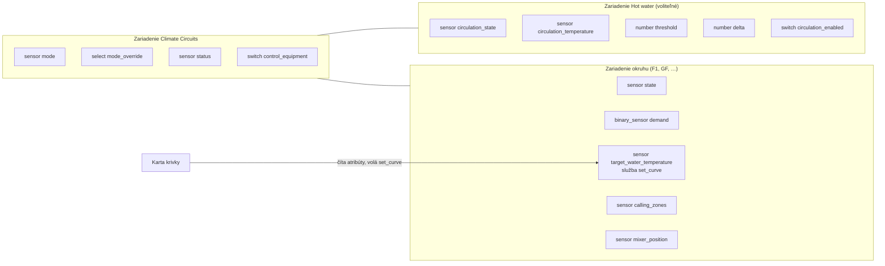

Parametre kriviek nie sú entity: mení ich karta cez službu `climate_circuits.set_curve`, ktorá zapisuje do subentry okruhu (formulár ukazuje to isté). Prah a delta cirkulácie zapisujú do options domu. Zmena kriviek alebo prahu/delty sa aplikuje bez reloadu, iné zmeny reloadujú.

## Aktivita (logbook) – Hotové

Integrácia zapisuje vlastné záznamy naviazané na svoje entity, takže sa zobrazia aj v Aktivite zariadenia:

| Záznam | Kedy | Príklad |
|---|---|---|
| Režim domu | zmena režimu alebo toho, čo rozhodlo; po štarte | „House mode: heating – decided by: Heat pump Heater (source entity heat)“ |
| Okruh | zmena stavu alebo zón, ktoré žiadajú teplo; po štarte | „F1: Not heating – no zone asks for heat: 8 reached target“ |
| Parameter krivky | zmena cez kartu / `set_curve` | „F1: Heating curve – design water temperature: 50 → 55“ |
| Cirkulácia TUV | čerpadlo zapne / vypne, cirkulácia zakázaná, senzor nedostupný | „Hot water: On – circulation 35.9 °C is below 36.0 °C (dry run, pump not switched)“ |
| Prah / delta cirkulácie | zmena number entity | „Hot water: Hot water circulation – threshold: 37 → 38“ |

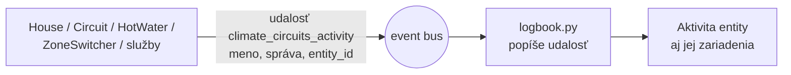

Cieľová teplota vody sa nezapisuje, mení sa príliš často. Texty sú v jazyku HA (sk / en).

## Karta krivky – Hotové

`custom:climate-circuits-curve-card`, súčasť integrácie: integrácia ju sama sprístupní (`/climate_circuits_frontend/…`) a zaregistruje ako Lovelace resource (`?v=<mtime>`, pri zmene súboru sa URL zmení), z HACS sa nič neinštaluje. `add_extra_js_url` nestačí: skript sa načíta pred výmenou registra custom elementov a karta sa potom nenájde.

Pridanie: dashboard → Upraviť → Pridať kartu → vyhľadať „Climate Circuits“, alebo YAML nižšie. V dome je na `/lovelace-configuration/climate-circuits`.

```yaml
type: custom:climate-circuits-curve-card
entity: sensor.f1_target_water_temperature
title: F1
```

- Prepínač Kúrenie / Chladenie, predvolene aktuálny režim domu.
- Kúrenie: ťahá sa návrhový bod (◆, návrhová teplota vody) a bod izby (●, posúva celú krivku); chladenie: bod strmosti (◆) a otočný bod (●, korekcia). V oboch čiary min a max.
- Prerušovane sa ukazuje krivka za hranicami min/max, plnou čiarou platná krivka, bod „teraz“.
- Popisky hodnôt: Room Temp., Min. External Temp., Water at Min. Ext. Temp., Exponent, Min, Max, Correction.
- Hodnoty pod grafom sa dajú upraviť kliknutím: pole na číslo, Enter alebo kliknutie mimo uloží, Esc zruší.
- Po pustení bodu alebo potvrdení hodnoty zavolá `climate_circuits.set_curve` so zmenenými parametrami; zmena sa objaví v Aktivite. Odmietnutú hodnotu (napr. min nad max) ukáže karta červeným textom.
- Os X sa rozširuje tak, aby oba ťahacie body ostali v grafe.

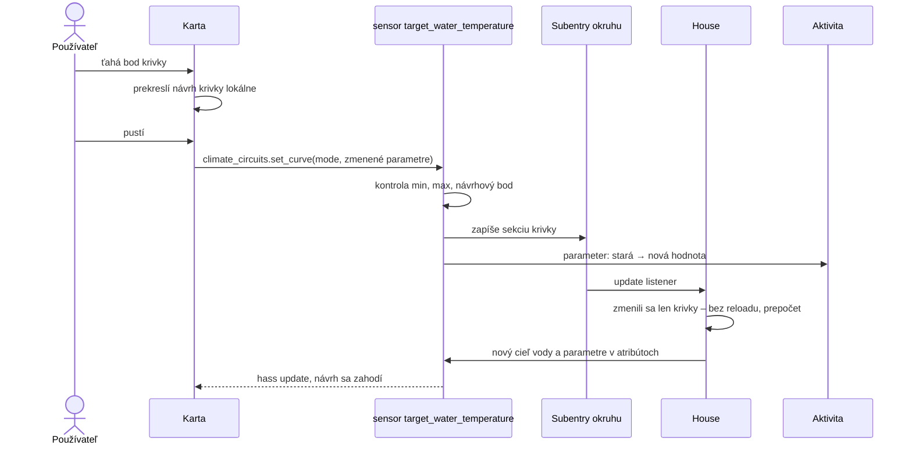

## Konfigurácia

**Dom (config entry, options):**

| Sekcia | Polia |
|---|---|
| Režim | schopnosti zdroja, entita zdroja režimu, hodnoty pre heat / cool / off |
| Záloha | druh (žiadna / nádrž / vonkajšia teplota), senzor, prahy kúrenia a chladenia |
| Počasie | senzor vonkajšej teploty |
| Termostaty zón | prepínať termostaty s režimom (predvolene áno) |
| Cirkulácia TUV | senzor teploty spiatočky cirkulácie, cirkulačné čerpadlo, prah, delta (voliteľné; bez senzora a čerpadla modul nevznikne) |
| Zobrazované senzory | senzory zobrazené v atribútoch režimu |

**Okruh (subentry):**

| Sekcia | Polia |
|---|---|
| Zóny | termostaty na kúrenie, termostaty na chladenie, vlhkomery |
| Krivka kúrenia | izba, návrhová vonkajšia teplota, návrhová teplota vody, exponent, min, max, korekcia |
| Krivka chladenia | izba, strmosť, min, max, korekcia |
| Výstupy | čerpadlo, relé zmiešavača otvor / zatvor, senzor za zmiešavačom, poloha zmiešavača (cover, len na zobrazenie), čas dráhy, hysteréza (zatiaľ sa neovládajú) |

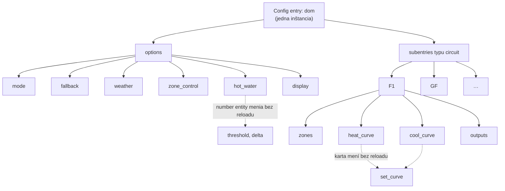

## Nasadenie

- Zatiaľ ručne: súbory sa nahrávajú cez app File editor do `/homeassistant/custom_components/climate_circuits/` a HA sa reštartuje. Veľkosti súborov sa overujú oproti lokálnym.
- Neskôr: GitHub repozitár `ha-climate-circuits` a HACS (custom repository).
- Vývoj: `uv venv --python 3.14 .venv`, `uv pip install -r requirements-dev.txt`, `pytest`, `ruff`.

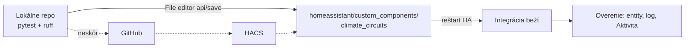

## Cirkulácia TUV – Hotové, nasadené (dry run)

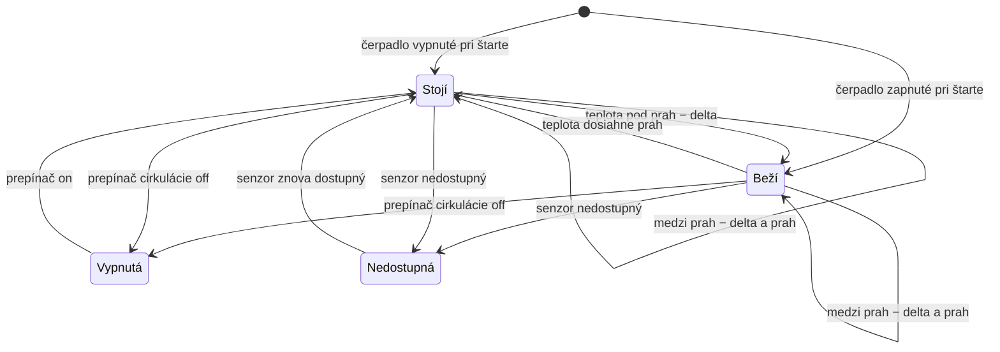

Hysteréza na teplote spiatočky cirkulácie:

| Teplota | Čerpadlo |
|---|---|
| pod prah − delta | zapne |
| medzi prah − delta a prah | drží predchádzajúci stav |
| prah a viac | vypne |
| senzor nedostupný | vypne |
| cirkulácia zakázaná prepínačom | vypne |

- Pamäť hysterézy je posledné rozhodnutie; po štarte sa naplní zo stavu čerpadla.
- Čerpadlo sa reálne spína iba pri zapnutom `control_equipment`, inak dry run (rozhodnutie je vidieť, čerpadlo sa nespína). Povel sa nezopakuje skôr ako o 10 s, kým sa stav čerpadla nezmení.
- Vyhodnocuje sa pri zmene teploty alebo čerpadla a každých 30 s.
- Jadro: `core/circulation.py`.

## Prepínanie termostatov pri zmene režimu – Hotové, nasadené (dry run)

Kúrenárske a chladiace termostaty zóny spínajú to isté zónové relé, preto smie byť aktívna iba jedna sada.

1. Pri zmene režimu sa vypnú termostaty opačného režimu (pri `off` všetky).
2. Termostaty nového režimu sa zapnú, až keď **všetky** opačné hlásia `off`.
3. Kým platí režim, termostat opačného režimu, ktorý sa zapne (plán, človek), sa znova vypne.
4. Povel sa opakuje každých 30 s; po 3 neúspešných pokusoch záznam v Aktivite a nová sada sa nezapne.
5. Plány (Climate Scheduler a pod.) integrácia neriadi; ak ich má používateľ zapínať a vypínať s režimom, spraví si na to vlastnú automatizáciu.
6. Termostat v oboch zoznamoch sa nevypína, iba prepne režim. Bez zdroja režimu (`default`) sa nič neprepína.
7. Iba pri zapnutom `control_equipment`, inak dry run so záznamom v Aktivite.

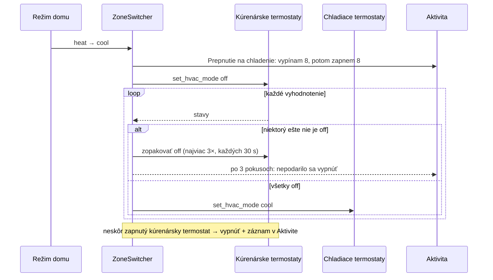

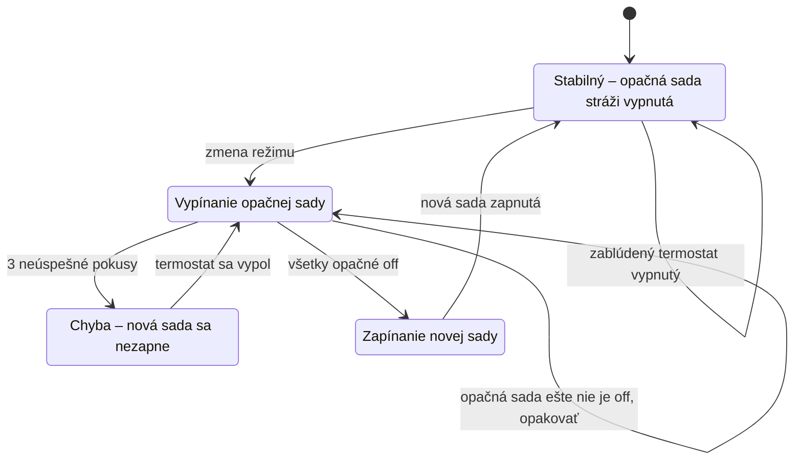

## Dnešný dom – mapovanie

| Dnes v HA | V integrácii |
|---|---|
| `sensor.cfg_hvac_mode` | `sensor.climate_circuits_mode`; zdroj = `climate.heat_pump_central_heating`, záloha `sensor.gf_watertank_up_temperature` 28 / 22 °C |
| `binary_sensor.cfg_f1_poziadavka` | `binary_sensor.f1_demand` + `sensor.f1_state` |
| `sensor.ekvitermicka_teplota_vody_radiatorov` | `sensor.<okruh>_target_water_temperature`, každý okruh vlastná krivka |
| `On Obehovky Temperatures Change` + `script.mixerautomation` | regulácia zmiešavača (míľnik 2) |
| `Control Obehovky` | riadenie čerpadla F1 (míľnik 2) |
| `HVAC Mode Switch` | prepínanie sady termostatov a plánov (hotové, nasadené v dry run) |
| `script.homezmiesavace` + `Mixers Homing Guard` + `OnHomeAssistantStarted` | homing zmiešavačov (míľnik 2) |
| `cover.gf_mixer_up` / `cover.gf_mixer_down` (`cover_time_based`) | poloha počítaná integráciou priamo nad relé |
| `kurenie_pri_okne`, Window Climate | modul okien (míľnik 3) |
| GF čerpadlo (bez vlastníka) | čerpadlo okruhu GF bez zón: on pri heat/cool (míľnik 2) |
| `Water Circulation Cycle` (`automation.water_heating_cycle`, každých 10 s) | cirkulácia TUV: `sensor.gf_heating_cycle_temperature`, `switch.gf_heating_cycle_pump`, prah/delta z `input_number.cfg_circular_temperature_threshold` / `cfg_circular_pump_delta` (37 / 1) |

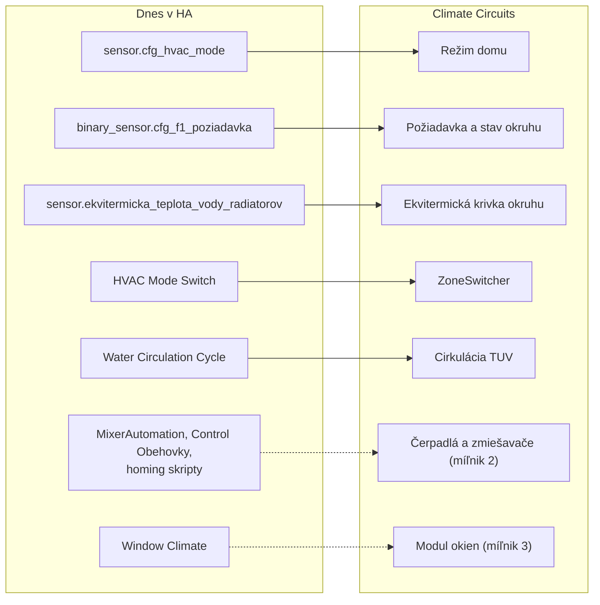

**Okruhy dnešného domu:**

| Okruh | Zmiešavač (relé) | Senzor za zmiešavačom | Čerpadlo | Zóny | Krivka kúrenia |
|---|---|---|---|---|---|
| F1 (poschodie) | `switch.gf_mixer_up_open` / `_close` | `sensor.gf_mixer_up_temperature` | `switch.sa8r_011_sa8r_011_relay_7` | 8 kúrenie + 8 chladenie, 8 vlhkomerov | −15 °C → 50 °C, n 1,3, izba 22, 35–50 °C |
| GF (prízemie) | `switch.gf_mixer_down_open` / `_close` | `sensor.gf_mixer_down_temperature` | `switch.sa8r_011_sa8r_011_relay_8` | žiadne | rovnaká, kým sa neupresní |

## Míľniky

| Míľnik | Obsah | Stav |
|---|---|---|
| 1 | režim, požiadavka, krivky, vysvetlenie, Aktivita, karta – iba čítanie | Hotové, nasadené |
| 1b | cirkulácia TUV (prvý ovládaný výstup) | Hotové, nasadené (dry run) |
| 1c | prepínanie termostatov pri zmene režimu | Hotové, nasadené (dry run) |
| 2 | výstupy: čerpadlá, zmiešavač nad relé, potvrdzovanie povelov, dry run, homing | Plánované |
| 2b | ochrany: pauza heat↔cool, kondenzácia, mráz, protáčanie, zdroj tepla | Plánované |
| 3 | modul okien (z Window Climate) | Plánované |

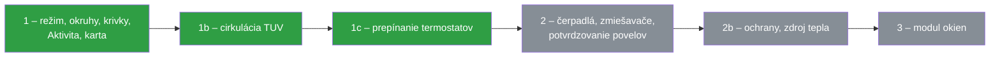
