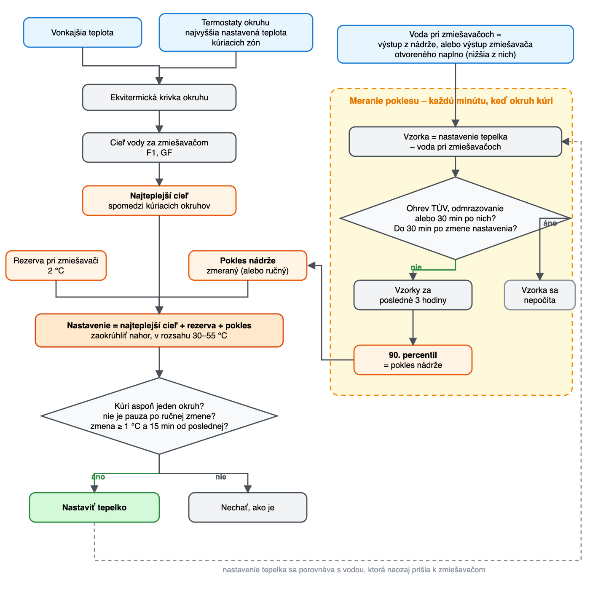
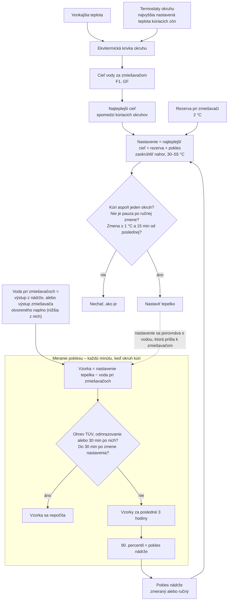

# Nastavovanie tepelka podľa okruhov – požadované správanie

Stav: schválené a implementované (2026-11-07, zatiaľ nevydané). Nahrádza učiacu sa rezervu (0.1.18–0.1.26).



## Požiadavka

**Voda, ktorá prichádza z akumulačky do zmiešavačov, má mať aspoň takú teplotu, akú žiadame za zmiešavačom, plus rezervu 2 °C.**

Tepelko si cieľ meria na vlastnom senzore. Voda pri zmiešavačoch je chladnejšia o **pokles nádrže**: rozdiel medzi vrchom nádrže a výstupom k zmiešavačom (~4 °C) a pokles, kým tepelko znova zapne (~4–5 °C). Integrácia preto nastaví tepelko o tento pokles vyššie a pokles **meria**.

## Výpočet

```
nastavenie tepelka = najteplejší cieľ kúriacich okruhov + rezerva + pokles nádrže
```

- **najteplejší cieľ:** cieľ vody za zmiešavačom z ekvitermickej krivky (vonkajšia teplota a najvyššia nastavená teplota kúriacich termostatov) spomedzi okruhov tohto zdroja, ktoré práve kúria;
- **rezerva:** 2 °C, entita *Rezerva pri zmiešavači*;
- **pokles nádrže:** zmeraný za posledné 3 h (entita *Okno merania*), alebo ručný (prepínač *Meraný / Ručne*).
- Zaokrúhlené nahor na krok tepelka, v rozsahu najnižšie – najvyššie nastavenie (30–55 °C), mení sa najviac raz za 15 min a o ≥ 1 °C. Bez kúrenia sa nemení.

## Meranie poklesu

Každú minutu, keď niektorý okruh kúri:

- vzorka = **nastavenie tepelka − voda pri zmiešavačoch**;
- voda pri zmiešavačoch = senzor výstupu z nádrže; ak je niektorý kúriaci zmiešavač naplno, jeho výstup je tiež voda z nádrže, berie sa nižšia z hodnôt;
- **nepočíta sa** počas ohrevu TÚV, odmrazovania a 30 min po nich (vtedy voda chýba kvôli nim, nie kvôli nastaveniu);
- **nepočíta sa** 30 min po zmene nastavenia tepelka (nádrž sa ešte len ohrieva / chladne – inak by sa nastavenie samo vyháňalo hore).

Pokles = 90. percentil vzoriek z okna 3 h, teda „takmer najhorší“ stav na spodku cyklov tepelka; jednotlivé výkyvy ho neovplyvnia. Kým je vzoriek menej ako za 30 min (napr. po reštarte), platí naposledy zmeraný pokles (na úplnom začiatku 8 °C). V ručnom režime meranie beží ďalej (atribút `measured`), platí však ručná hodnota.

Keď tepelko nestíha (voda pod nastavením aj po 30 min), pokles rastie a nastavenie ide hore až po *Najvyššie nastavenie* – to je zámer (voda pri zmiešavačoch má stačiť); strop chráni pred únikom.

## Čo uvidíš

- *Pokles nádrže* ako senzor zdroja (zmeraný), na karte aj v Aktivite pri každej zmene: „tepelko 54 °C = GF 44,2 + rezerva 2 + pokles 8 (3 h)“.
- *Zdroj nestačí*, *Ohrev TÚV*, *Odmrazovanie* ostávajú.

## Ostáva bez zmeny

Ručná zmena nastavenia tepelka pozastaví automatiku (1 min), bez kúrenia sa nemení, TÚV integrácia neriadi.

## Diagram (Mermaid)


