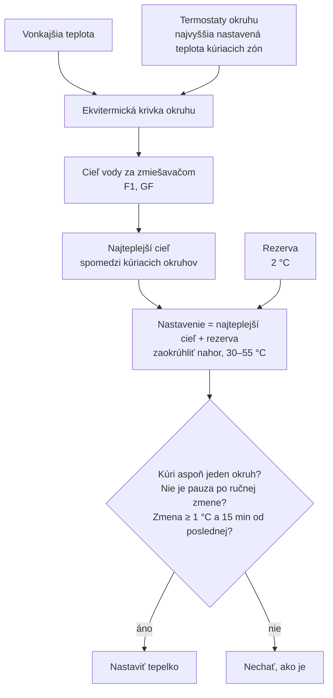

# Nastavovanie tepelka podľa okruhov

Stav: platí od 0.1.29 (2026-11-08). Nahrádza učiacu sa rezervu (0.1.18–0.1.27) a meraný pokles nádrže (0.1.28).


## Pravidlo

```
nastavenie tepelka = najteplejší cieľ kúriacich okruhov + rezerva
```

- **Cieľ okruhu** = ekvitermická hodnota: voda za zmiešavačom podľa krivky okruhu z vonkajšej teploty a najvyššej nastavenej teploty kúriacich termostatov okruhu (prepínač *Krivka podľa termostatov*).
- **Najteplejší** = najvyšší z okruhov tohto zdroja, ktoré práve kúria.
- **Rezerva** = 2 °C, entita *Rezerva nad najteplejším okruhom* pri zdroji.
- Zaokrúhli sa nahor na krok tepelka (1 °C), orezané na *Najnižšie – Najvyššie nastavenie* (30–55 °C).

Príklad (8. 11. ráno): F1 45,7 °C (vonku −1,3 °C, izba 23 °C), GF 45,5 °C → 45,7 + 2 = 47,7 → **48 °C**.

## Kedy sa mení

- Vyhodnocuje sa každých 30 s a pri každej zmene vstupu (termostat, vonkajšia teplota, nastavenie tepelka).
- Do tepelka sa zapíše, len keď: od poslednej zmeny prešlo ≥ 15 min, nová hodnota sa líši o ≥ 1 °C, niektorý okruh kúri, nie je pauza po ručnej zmene (1 min), prepínač *Tepelné čerpadlo riadi integrácia* a *Ovládať zariadenia* sú zapnuté. Prvá zmena po štarte HA môže prísť hneď.
- V praxi sa mení, keď sa zmení vonkajšia teplota (`sensor.outside_temperature` ~1× za hodinu) alebo plánovač zmení teplotu termostatov.

## Prečo nie meranie poklesu (0.1.28)

Meraný pokles (nastavenie − voda pri zmiešavačoch, 90. percentil za 3 h) vyšiel v prvú noc 14,2 °C – zachytil poklesy vody pri každom štarte tepelka a to, že voda z nádrže je aj na vrchu cyklu ~6–7 °C pod nastavením. Výsledok 61,9 °C → strop 55 °C a na strope sa zamkol. Používateľ rozhodol: jednoduché pravidlo, cieľ + 2 °C. Ak voda pre okruhy nebude stačiť (*Zdroj nestačí*, zmiešavač naplno pod cieľom), zvýši sa rezerva.

## Ostáva

Ručná zmena nastavenia tepelka pozastaví automatiku (1 min). TÚV a odmrazovanie sa rozpoznávajú a zobrazujú, nastavenie neovplyvňujú. TÚV integrácia neriadi.

<details><summary>Zdroj diagramu (Mermaid)</summary>



</details>
