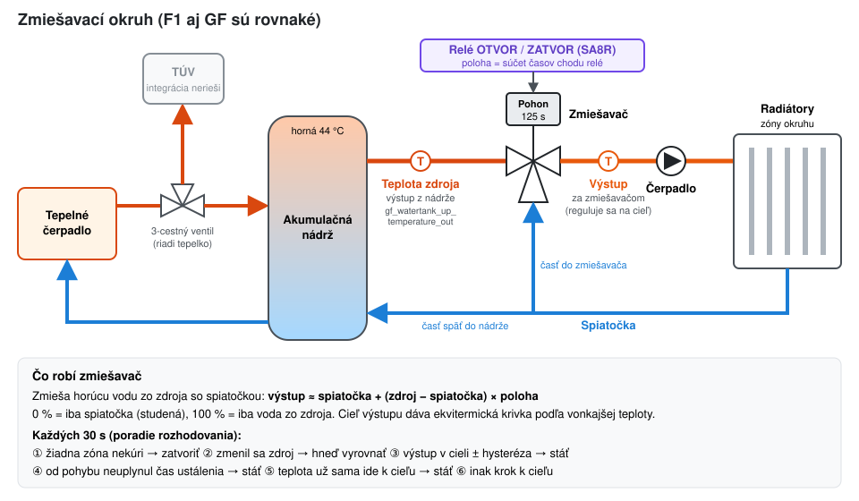

# Zmiešavače – ako fungujú

## Hydraulika
- Tepelné čerpadlo ohrieva akumulačnú nádrž (alebo TÚV – o tom rozhoduje jeho trojcestný ventil, integrácia TÚV nerieši).
- Zmiešavač okruhu zmieša horúcu vodu z nádrže so spiatočkou z radiátorov:
  `výstup ≈ spiatočka + (zdroj − spiatočka) × poloha`.
  0 % = iba spiatočka, 100 % = iba voda zo zdroja.
- **Teplota zdroja** = teplota vody, ktorá do zmiešavača naozaj prichádza (senzor na výstupnom potrubí nádrže), nie horná časť nádrže.
- **Výstup** = senzor za zmiešavačom; reguluje sa na cieľ z ekvitermickej krivky.

## Poloha bez snímača
Ventil nehlási polohu. Integrácia ju počíta z času chodu relé OTVOR / ZATVOR (`čas dráhy` = 0 → 100 %). Keď polohu nepozná, zatvorí ventil celou dráhou + 2 s (homing) a počíta od 0 %.

## Rozhodovanie (každých 30 s)
1. Žiadna zóna nekúri → zatvoriť; na doraze dotlak 2 s raz za 6 h. Prvých 90 s po štarte HA sa nezatvára (zóny sa ešte načítavajú).
2. Zmenila sa teplota zdroja (len kúrenie, ak je zapnuté *Sledovať zdroj tepla*) → hneď posun o `−p·(1−p)·ΔT / (zdroj − výstup)`, aby výstup ostal rovnaký. Len ak je zdroj aspoň o *Najmenší rozdiel zdroj – výstup* teplejší (predvolene 3 °C) a posun je aspoň *Najmenší krok*.
3. Výstup je v cieli ± hysteréza → stáť.
4. Od posledného pohybu ešte neuplynul *Čas ustálenia* → stáť (voda ešte nedotiekla k senzoru).
5. Podľa trendu za *Okno trendu* sa výstup do času ustálenia dostane k cieľu sám → stáť.
6. Inak krok k cieľu: *Krok na 1 °C odchýlky* × odchýlka, medzi *Najmenším* a *Najväčším krokom*. Na doraze iba dotlak 2 s raz za 10 min.

Ak je ventil naplno (≥ 99 %) a výstup je aj tak 15 min pod cieľom, Aktivita zapíše „zdroj nestačí“.

## Parametre (okruh → Prekonfigurovať → Regulácia zmiešavača)

| Parameter | Predvolene | Čo robí |
|---|---|---|
| Čas celej dráhy ventilu | 125 s | z pohonu (štítok); z neho sa počíta poloha |
| Hysteréza | 0,5 °C | pásmo okolo cieľa, v ktorom ventil stojí |
| Čas ustálenia | 150 s | čakanie po pohybe, kým voda dotečie k senzoru |
| Krok na 1 °C odchýlky | 4 %/°C | väčší = rýchlejšie, ale môže prestreliť |
| Najmenší krok | 2 % | menší pohyb vodu nezmení |
| Najväčší krok | 20 % | obmedzí jeden pohyb ďaleko od cieľa |
| Okno trendu | 120 s | z koľkých sekúnd merania sa berie smer teploty |
| Sledovať zdroj tepla | áno | kompenzácia zmeny teploty zdroja |
| Najmenší rozdiel zdroj – výstup | 3 °C | pod ním kompenzácia nebeží (šum senzora by hýbal ventilom) |

Zmena parametrov znovu načíta integráciu; poloha ventilu sa zachová.

## Nedostupné relé
- **Krátky výpadok (do 5 s)** – doska SA8R občas na chvíľu vypadne. Pohyb sa počíta ďalej, nič sa nehlási.
- **Dlhší výpadok v kľude** – Aktivita: „relé je nedostupné“, zmiešavač nič nespína (stav *Relé nedostupné*), poloha ostáva. Po návrate: „relé je znova dostupné“ a regulácia pokračuje.
- **Výpadok počas pohybu** – nevie sa, ako dlho relé bežalo: poloha je neznáma, Aktivita to zapíše a po návrate relé sa ventil zahomuje.
- **Relé sa po návrate ukáže zapnuté** bez príkazu (oneskorený príkaz) → integrácia ho hneď vypne a zapíše.
- **Poistka integrácie:** relé zapnuté dlhšie ako dráha + rezerva sa vypne.
- **Čo integrácia nevie:** ak doska stratí spojenie s HA práve počas pohybu, relé na doske beží ďalej, kým sa spojenie nevráti (alebo kým pohon nedôjde na koncový spínač). Proti tomu pomôže iba poistka priamo vo firmvéri dosky (max. doba zopnutia relé zmiešavača) – zatiaľ nenasadené.
- Čerpadlo: pri nedostupnom relé tiež záznam v Aktivite (výpadok aj návrat).
